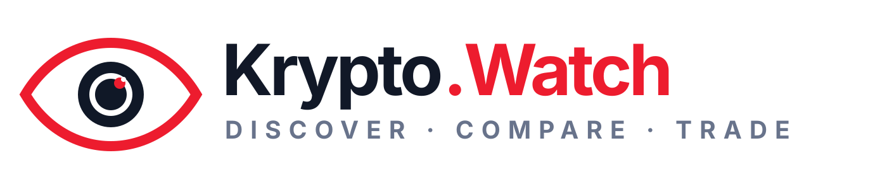

<strong>◉ DISCOVER · COMPARE · TRADE</strong> OPEN CRYPTO RESEARCH · BUILT IN THE OPEN

<a href="https://github.com/KryptoWatch/awesome-crypto-exchanges">EXCHANGES</a> · <a href="https://github.com/KryptoWatch/awesome-crypto-swaps">SWAPS</a> · <a href="https://github.com/KryptoWatch/crypto-security-toolkit">SECURITY</a> · <a href="https://github.com/KryptoWatch/crypto-api-directory">DEVELOPER APIs</a> · <a href="https://x.com/KryptodotWatch">𝕏</a>

---

<h1 align="center">⚡ Awesome Crypto Swaps</h1>

A clear, source-linked field guide to crypto swap services, cross-chain protocols, and aggregators.

  

<a href="#directory">Explore directory</a> · <a href="#compare-before-using">Compare routes</a> · <a href="#contribute">Contribute</a> · <a href="https://github.com/KryptoWatch">Krypto.Watch</a>

---

> **Use this as a research starting point.** Inclusion is not an endorsement or recommendation. A swap can fail, be delayed, or return less than expected. Check the route, quote, network, addresses, and current terms before sending assets.

## Directory

Services are grouped by execution model. Order is editorial and does not rank quality or safety.

### Hosted or service-operated swaps

| Service | Official information | What to verify |
| --- | --- | --- |
| [ChangeNOW](https://changenow.io/) | [Terms of use](https://changenow.io/terms-of-use/changenow-terms) | Its terms describe indicative classic-rate quotes, third-party liquidity providers, AML/KYC checks, and jurisdiction restrictions. Review the current terms for your region and service. |
| [ChainSwap](https://chainswap.io/) | [How it works](https://chainswap.io/how-it-works) · [Terms](https://chainswap.io/term-condition) | Its site describes a wallet-to-wallet swap service. Verify the exact route, quote type, supported assets, and terms for each order. Last checked: 2026-11-01. |
| [SimpleSwap](https://simpleswap.io/) | [FAQ](https://simpleswap.io/faq) · [Terms of Service](https://simpleswap.io/terms-of-service) | Its FAQ describes a self-custodial, multi-source swap aggregator with fixed and floating rates. Check the selected providers, available pair, quote, and any verification requirements. Last checked: 2026-11-01. |
| [SecureShift](https://secureshift.io/) | [Exchange](https://secureshift.io/) · [Terms of Service](https://secureshift.io/terms-condition) | Its terms describe fixed and floating rates and allow orders to be suspended for source-of-funds checks, with identity checks possible in some cases. The terms page says it was updated August 22, 2024; verify current terms, restrictions, and order details. Last checked: 2026-11-01. |
| [Godex](https://godex.io/) | [How it works](https://godex.io/how-it-works) · [Terms of Use](https://godex.io/terms-of-use) | The published terms describe a 30-minute rate lock and jurisdiction restrictions, and are dated December 25, 2020. Verify the current terms, quote expiry, destination details, and refund conditions before sending. Last checked: 2026-11-01. |
| [Wagyu](https://wagyu.xyz/) | [Swap details](https://wagyu.xyz/) · [Compliance Policy](https://docs.wagyu.xyz/compliance-policy) | Its site describes cross-chain routing through an aggregator and XMR trades via Hyperliquid's orderbook; it says the Monero bridge leg is Wagyu-operated and screening/refund rules apply. Verify route-specific fees, limits, and policy before sending. Last checked: 2026-11-01. |

